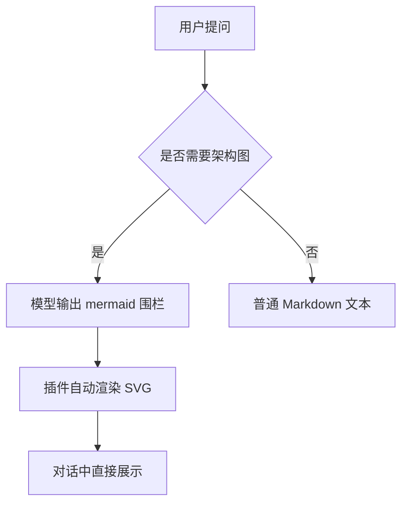

# dsh-client-ui-showcase — 提交到 DSH 开源社区

> 把 展示优化 对话里的展示与交互增强，打包成独立 DSH 插件，注入对话界面。
> 零运行时依赖，MIT 开源，即装即用。

---

## 一、插件简介

展示优化是一个纯前端 DOM 增强引擎，为 DSH Desktop 对话界面设计。它不改 DSH 源码、不改聊天组件、不依赖任何 UI 框架，只监听 DOM 变化，把模型输出的特定代码块自动升级成富交互组件。

引擎采用旁挂策略：隐藏原代码块，在它旁边挂载渲染后的组件。React 后续卸载原节点时，孤儿回收器自动清理残留组件，不会白屏或冲突。

一句话：**模型照常输出代码块，插件自动升级为可视化组件**——SVG 图表、HTML 卡片、Mermaid 架构图、数学公式、文件卡片、可折叠推理块，全部在对话里直接呈现。

---

## 二、核心能力

| # | 能力 | 触发写法 | 效果 |
|---|------|----------|------|
| 1 | 内联 SVG 图标与架构图 | ```` ```svg ```` 围栏或 `<dsh-svg>` | 原始 SVG 渲染成真实图形，玫瑰棕卡片边框加复制 SVG 按钮 |
| 2 | 内联 HTML 组件 | ```` ```html ```` 围栏或 `<dsh-html>` | 渲染净化后的 HTML 片段，可做卡片、表格、布局 |
| 3 | Mermaid 架构图 | ```` ```mermaid ```` 围栏 | 懒加载 mermaid 渲染成 SVG 流程图、时序图、类图，离线降级为代码块 |
| 4 | 数学公式 | ```` ```math ```` 围栏 | 懒加载 KaTeX 渲染，离线降级 |
| 5 | Artifact 文件卡片 | ```` ```artifact ````（JSON 或 key: value） | 可点击文件或链接卡片，按类型显示图标 |
| 6 | 可折叠推理块 | ```` ```reasoning ```` / ```` ```tool ```` / ```` ```thinking ```` | 收进 details，标题显示字符数，默认收起（工具调用默认展开） |
| 7 | 代码块增强 | 任意普通代码块 | 悬浮复制按钮加语言徽章 |
| 8 | 主题美化 | 全局 | 玫瑰棕主色、表格斑马纹、圆角卡片、引用条 |
| 9 | 一键开关 | 右下角浮动按钮 | 随时开关整套餐，状态持久化 |

---

## 三、使用案例

### 案例 1：对话里直接出架构图

**原来**：用户问「画一个微服务架构图」，模型回一段 Mermaid 代码，用户复制到外部编辑器打开。

**装上之后**：模型输出 mermaid 围栏，插件自动渲染成 SVG 流程图，直接出现在对话气泡里，可以即时看图讨论。



### 案例 2：数据分析报告可视化

用户上传数据，模型分析后生成 SVG 柱状图、折线图。插件把 SVG 渲染成图表，用户在聊天界面里就能看趋势，不用离开对话。

### 案例 3：多步 Agent 推理过程

长推理过程折叠成「🧠 推理过程（N 字符）」，工具调用展示为「🛠 工具调用」并默认展开。对话界面保持清爽，需要时再展开细节。

### 案例 4：知识库文档卡片

模型推荐文档时用 artifact 围栏输出标题、类型、链接，插件渲染成带文件图标、标题、描述的可点击卡片：

```artifact
{
  "title": "DSH 插件开发指南",
  "type": "pdf",
  "url": "https://example.com/dsh-plugin-guide.pdf",
  "description": "v1.0 插件开发规范与示例"
}
```

### 案例 5：公式教学

数学、物理、工程问题里的公式用 math 围栏，插件渲染成 KaTeX 格式，清晰美观。

---

## 四、核心优势

### 对比 DSH 原生渲染

| 维度 | DSH 原生 | 展示优化 |
|------|----------|----------------|
| SVG 图表 | 代码块，看不到图 | 真实 SVG 渲染加复制按钮 |
| HTML 组件 | 代码块，显示源码 | 渲染后的卡片或表格 |
| Mermaid 架构图 | 不原生支持 | 懒加载渲染成 SVG |
| 数学公式 | 不原生支持 | KaTeX 渲染 |
| 文件与链接卡片 | 不原生支持 | 可点击 Artifact 卡片 |
| 推理过程折叠 | 整段代码块占空间 | 可折叠详情块 |
| 代码块复制 | 原生已有按钮 | 对无语言类代码块补按钮，互补不重复 |
| 主题美化 | 默认主题 | 玫瑰棕配色加圆角卡片 |

### 对比其他方案

| 对比项 | 其他做法 | 展示优化 |
|--------|----------|----------------|
| 集成方式 | 改 DSH 源码或重写前端 | 纯插件安装，零侵入 |
| 框架依赖 | 依赖 React 或 Vue | 纯 DOM，零框架依赖 |
| 安全性 | 依赖框架自带净化 | allowlist 净化器加危险 URI 过滤 |
| 离线能力 | 通常依赖在线 CDN | Mermaid 与公式离线降级为代码块，不报错 |
| 稳定性 | 可能破坏 React 渲染 | 旁挂式加孤儿回收，不触发 React 错误 |
| 开关 | 需要改配置 | 右下角浮动按钮一键开关 |

### 技术亮点

1. 旁挂式 DOM 增强：mountBeside 加孤儿回收，不触发 React unmount 错误
2. 零运行时依赖：dependencies 为空，只用浏览器 API
3. 自包含 client bundle：净化器、引擎、样式全部内联，不依赖相对 import
4. 惰性启动：requestIdleCallback 加 DOM ready 延迟，不阻塞首屏
5. 安全净化：剥离 script、on* 与危险 URI，提示注入也无法执行 JS
6. CDN 懒加载：Mermaid 与 KaTeX 按需加载，失败自动降级
7. 可配置：每个功能独立开关，CDN 地址可换成本地路径

---

## 五、测试结论

完整对照数据见 `测试数据.md`，含 8 类用例和 A/B 对照方法。已验证：

- Host 半侧加载日志正常
- Client 半侧在渲染进程执行，渲染进程健康
- 无插件相关报错
- 右下角浮动按钮正常
- 8 类代码块升级全部通过
- 一键开关状态持久化
- 开关切换只影响之后的新消息，互不污染

---

## 六、安装

```yaml
# profile 根目录 cordis.patch.yml 追加
- insert:
    - id: showcase
      name: dsh-client-ui-showcase
```

或渲染进程直引：

```js
import { startShowcase } from 'dsh-client-ui-showcase'
startShowcase({ enabled: true })
```

---

## 七、许可证

MIT License。

---

## 八、下一步

- 发布到 npm registry
- 提交到 DSH 社区市场目录（1024Store / dshfind.com）
- 补充 Mermaid 与 KaTeX 的本地 vendored 版本，支持纯离线
- 可选：切换为 conversation.chat.node 插槽级渲染（需先确认 props 契约）
