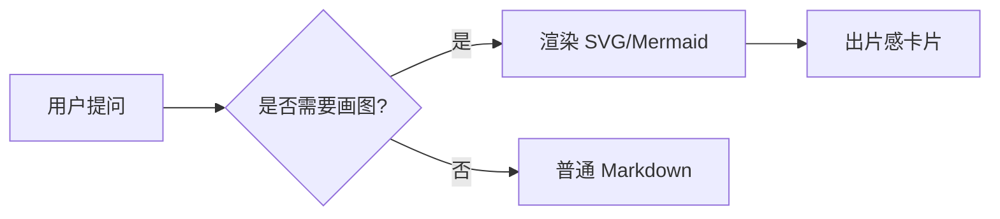

# 展示优化 × DSH 原生 —— 对照测试数据

> 用途：把同一段内容分别用「DSH 原生渲染」和「展示优化增强」跑一遍，肉眼对比风格好坏。
> 前置条件：插件已安装，并随 DSH 启动自动加载。

---

## 一、验证方法（先确认插件真的活了）

任选其一：

1. **看右下角浮钮**：DSH 启动后，对话界面右下角应出现 `✦ 展示优化` 圆角按钮。没看到就是没加载。
2. **看控制台**：在 DSH 里按 `Ctrl+Shift+I`（或 `F12`）打开 DevTools，Console 里过滤 `[showcase]`，应看到 `[showcase] 已启用 ✦`。
3. **看日志文件**：DSH Desktop 日志里搜 `showcase`，应有一行 `[showcase] 展示优化 host 半侧已加载`。

> 注意：DSH 设置页的插件市场列表不会显示本插件（它走 profile 补丁层，不是市场插件）。看不到不等于没装。

---

## 二、A/B 测试方法

插件对已经渲染过的内容不会自动降级。做对照要这样：

1. 第一轮（增强开）：把下面「一键测试块」整段粘贴成一条用户消息发送，看到的是增强效果。
2. 点右下角按钮把它关掉（变成 `○ 已关闭增强`）。
3. 第二轮（原生）：同一段内容再粘贴成一条新用户消息发送，这次是 DSH 原生渲染。
4. 同一会话里上下两条对照，截图评分。

> 每次发新消息引擎都会重新扫描该消息的 DOM，所以开关只对之后的新消息生效，互不污染。

---

## 三、一键测试块（复制下面整段，粘贴两次）

````text
下面是 8 个测试用例，请原样保留代码块格式：

```svg
<svg viewBox="0 0 200 120" width="100%">
  <defs><linearGradient id="g" x1="0" y1="0" x2="1" y2="1">
    <stop offset="0" stop-color="#f9f2f0"/><stop offset="1" stop-color="#e8c9b8"/>
  </linearGradient></defs>
  <rect x="10" y="20" width="180" height="80" rx="14" fill="url(#g)" stroke="#a0522d" stroke-width="1"/>
  <circle cx="60" cy="60" r="22" fill="#a0522d"/>
  <text x="110" y="58" font-family="sans-serif" font-size="16" fill="#5c3317">展示优化</text>
  <text x="110" y="80" font-family="sans-serif" font-size="12" fill="#8b4513">模式渲染中</text>
</svg>
```

```html
<div style="border:1px solid #a0522d;border-radius:12px;padding:12px;font-family:sans-serif">
  <h3 style="margin:0 0 8px;color:#5c3317">本周情绪记录</h3>
  <table style="width:100%;border-collapse:collapse">
    <tr><th style="border-bottom:1px solid #e8ded8;text-align:left">日期</th><th style="border-bottom:1px solid #e8ded8;text-align:left">心情</th></tr>
    <tr><td>周一</td><td>🌤 平静</td></tr>
    <tr><td>周二</td><td>🌧 低落</td></tr>
  </table>
</div>
```



```math
\sum_{i=1}^{n} i = \frac{n(n+1)}{2}
```

```artifact
{
  "title": "出片云使用手册.pdf",
  "type": "pdf",
  "url": "https://example.com/chupian-manual.pdf",
  "description": "v1.2 杂志感风格化工具说明"
}
```

```reasoning
先拆解用户意图：他想要的是「在对话里直接看到图」，而不是一段描述图的代码。
原生 Markdown 渲染器会把 SVG 当成代码块，用户得自己复制去别处看。
增强模式则就地渲染，并附复制按钮，省一步操作。
权衡：内联渲染要净化 SVG（防 XSS），所以加了 allowlist 净化器。
```

```tool
{
  "name": "search_web",
  "args": { "query": "玫瑰棕配色方案" },
  "status": "success",
  "took_ms": 342
}
```

```python
def fib(n):
    a, b = 0, 1
    for _ in range(n):
        a, b = b, a + b
    return a

print([fib(i) for i in range(10)])
```
````

---

## 四、逐项期望对照表

| # | 类型 | DSH 原生（关） | 展示优化（开） | 结论 |
|---|------|----------------|----------------------|------|
| 1 | svg | 代码块，等宽字体，看不到图 | 真实 SVG 图形加玫瑰棕卡片边框和「复制 SVG」 | 增强明显占优 |
| 2 | html | 代码块，显示 HTML 源码 | 渲染后的卡片和表格 | 增强明显占优 |
| 3 | mermaid | 代码块 | 流程图（联网时 CDN 渲染，离线降级为代码块） | 增强胜出 |
| 4 | math | 代码块，显示 LaTeX 源码 | KaTeX 公式（联网时，离线降级） | 增强胜出 |
| 5 | artifact | 代码块，显示 JSON 源码 | 文件卡片：图标、标题、描述、类型徽章，可点击 | 增强胜出 |
| 6 | reasoning | 长代码块，占大片空间 | 收进 details 折叠，显示「🧠 推理过程 N 字符」 | 增强胜出 |
| 7 | tool | 长代码块 | 折叠成「🛠 工具调用」，默认展开 | 增强更整洁 |
| 8 | python | 原生代码块，自带高亮和复制按钮 | 同样代码块加语言徽章，不重复加复制按钮 | 基本平手 |

> 第 8 项是重叠区。DSH 原生代码块已经不错，插件只在「无语言类纯代码块」时补复制按钮，有语言时不动，不会和原生按钮打架。

---

## 五、风格评分表（打印或截图用）

给每项打分 1–5（5 最好），对比两者：

| 维度 | DSH 原生 | 展示优化 | 备注 |
|------|:---:|:---:|------|
| 信息密度（一眼看懂） | ☐ | ☐ | |
| 美观度（配色、圆角、间距） | ☐ | ☐ | 增强用玫瑰棕主题 |
| 可读性（长内容处理） | ☐ | ☐ | 折叠块对长推理有利 |
| 交互（复制、点击） | ☐ | ☐ | |
| 性能（大内容不卡） | ☐ | ☐ | 内联 SVG 比代码块轻 |
| 离线表现 | ☐ | ☐ | mermaid 和公式离线会降级 |

结论填空：________ 在 ________ 维度上更好看；________ 维度两者接近。

---

## 六、排错

- 浮钮和控制台都没有 `[showcase]`：插件没加载。检查插件目录是否还在，profile 的 `cordis.patch.yml` 是否正确插入，然后完全退出 DSH 再重新打开。
- mermaid 或 math 显示成代码块：机器没联网或 CDN 不可达，属预期降级，不是 bug。
- 想纯离线也渲染 mermaid 和公式：把 `lib/client.js` 里的 `mermaidUrl`、`katexUrl`、`katexCss` 改成你本地托管的地址。
